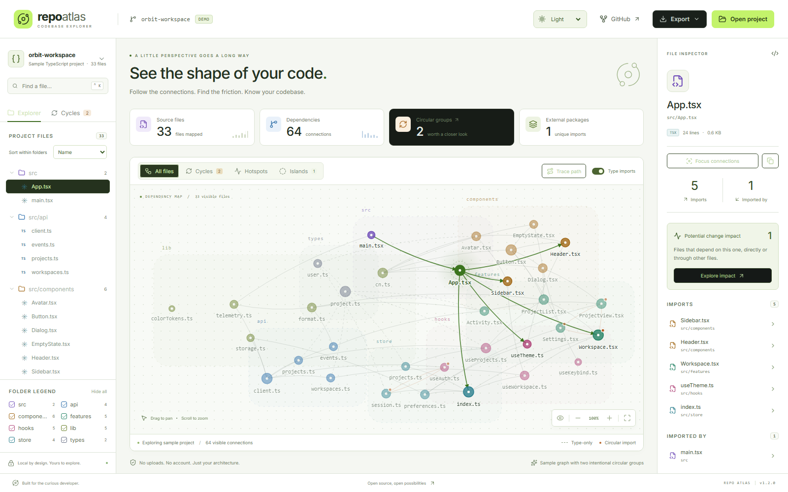
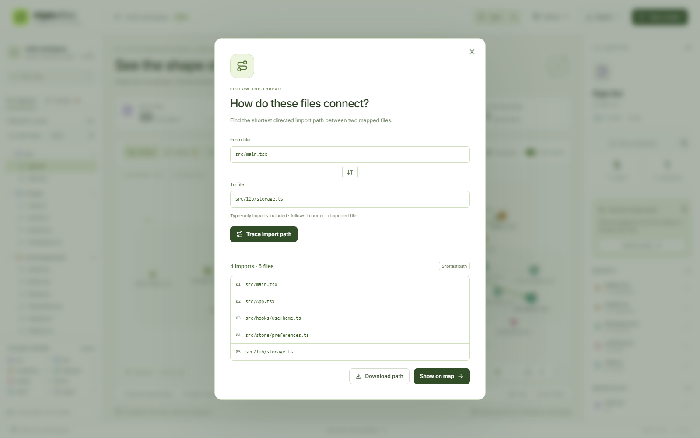

<div align="center">


# Repo Atlas

### See the shape of your code.

An interactive dependency map for JavaScript and TypeScript projects.<br />
Follow the connections. Find the friction. Know your codebase.

[](https://github.com/hiamtrung103/repo-atlas/actions/workflows/ci.yml)
[](LICENSE)
[](#privacy)

**[Explore the live demo →](https://hiamtrung103.github.io/repo-atlas/)** · [Quick start](#quick-start) · [How it works](#how-it-works) · [Tiếng Việt](docs/README.vi.md)


</div>

<details>
<summary>Prefer a lighter view? See the light appearance.</summary>



</details>

## Why Atlas?

Reading one file tells you what it does. Seeing its connections tells you where it belongs.

Repo Atlas turns a local project into an explorable graph. Trace the files that depend on a module before refactoring it, spot highly connected utility files, or inspect circular import groups without setting up a backend.

## Features

- **Interactive map** — folder colors, file labels, pan, zoom, and an inspector for imports and dependents.
- **Real syntax parsing** — TypeScript's compiler API reads imports, re-exports, literal dynamic imports, CommonJS `require`, and type-only dependencies.
- **Circular groups** — strongly connected component analysis finds multi-file cycles and self-imports. Internal circular edges are highlighted.
- **Architectural hotspots** — explore the top 20% of files by total incoming and outgoing connections.
- **Change impact & focus** — isolate a file's immediate connections or trace all its transitive dependents before a refactor. Copy the selected path from the inspector.
- **Import path finder** — find the shortest directed chain between two files, show only that route on the map, or download the complete path.
- **Islands & sorted exploration** — inspect files without mapped local connections; sort files within each folder by name, connection count, or source size.
- **Light, dark & system** — switch appearance from the header, keep your preference across reloads, or follow your device automatically. The graph and SVG exports use the same palette.
- **Search & filters** — search paths, toggle folders, or exclude type-only edges to distinguish runtime relationships.
- **Portable exports** — save a source-free JSON graph, an SVG of the current map, or a Markdown architecture report.
- **Browser + CLI** — select a folder in the browser or scan one from your terminal.
- **Local-first** — no account, API key, telemetry, or source-code upload. Parsing runs in a Web Worker.

## Quick start

Requires **Node.js 20.19+ or 22.12+** and npm. Node 22 is used in CI.

```bash
git clone https://github.com/hiamtrung103/repo-atlas.git
cd repo-atlas
npm ci
npm run dev
```

Open the local URL printed by Vite. The illustrative demo loads immediately. Choose **Open project → Choose a project folder** to map your own codebase.

To try a small real project, select `examples/tiny-project`. It includes an alias, type imports, a dynamic import, and one intentional circular group.

### Scan from your terminal

Run from the Repo Atlas checkout:

```bash
npm run scan -- /path/to/project --out my-project.atlas.json
```

Then choose **Open project → Import an Atlas graph** in the viewer. The CLI refuses to overwrite an existing output file; use a new `--out` path for another scan. On Windows, quote paths containing spaces.

```powershell
npm run scan -- "D:\Projects\My App" --out my-app.atlas.json
```

### Build a static viewer

```bash
npm run build
npm run preview
```

The `dist/` directory is a static site. Assets use relative URLs, including the scanner worker, so it can be hosted under a repository subpath. The GitHub Pages workflow publishes the viewer from `main`.

## Reading the map

| Visual                      | Meaning                                 |
| --------------------------- | --------------------------------------- |
| Node color                  | Folder group                            |
| Solid connection            | Static, dynamic, or CommonJS dependency |
| Dashed connection           | Type-only dependency                    |
| Orange dot                  | File belongs to a circular group        |
| Arrow on a highlighted edge | Importer → imported file                |
| Larger node in Hotspots     | More total imports and dependents       |

Click a file to inspect both directions. Hover a node to trace its neighbors. Use `Ctrl/⌘ K` to focus search, drag empty map space to pan, and use the zoom controls or mouse wheel to zoom. Graph nodes also support keyboard focus and Enter/Space selection.

Use **Focus connections** in the inspector to isolate the selected file, its imports, and its direct dependents. **Explore impact** instead follows incoming edges transitively and includes the selected file in the map. The impact counter counts other files only. Both operations clear search and folder filters; **Show all** restores the full view. The type-import toggle still applies.

Change impact describes structural reachability in the mapped sources; it does not predict whether a code change will cause a runtime failure. It follows the same resolver limits as the main graph.

### Trace an import path

Choose **Trace path**, enter two existing full file paths (the fields suggest paths from the current project), and select **Trace import path**. The result is the shortest chain by import count, following importer → imported file. **Swap endpoints** explores the reverse direction, which can have a different result. A file traced to itself has zero imports.

**Show on map** clears the current search, folder filters, and focus mode, then isolates the route and its consecutive directed edges. Changing **Type imports** recalculates the path automatically, including alternate routes. If no path remains under that filter, the banner says so; re-enabling the filter can restore it. **Show all** exits the traced view.

The result preview lists up to 100 steps; **Download path** exports the entire route as text. The map retains its 350-file rendering limit and shows the first matching route files in path order. Search can reveal later steps. The Markdown report also includes the full active path. A missing route can reflect unresolved or nonliteral imports outside the scanner's scope, rather than proving that two files never interact at runtime.

<details>
<summary>See the path finder</summary>



</details>

### Explore islands and sort files

**Islands** shows files with zero mapped imports and zero mapped dependents under the current type-import filter. They can still be entry points, use external packages, or be loaded through nonliteral imports; this view is not proof of unused code. The illustrative demo includes one disconnected file to try it.

The Explorer's **Sort within folders** control orders files by name, total connections, or byte size. Folder groups keep their order and sorting the list does not rearrange the map. Architecture reports include the isolated-file list alongside circular groups and hotspots.

### Appearance

The **Appearance** selector in the header offers Light, Dark, and System. System is the default. An explicit choice survives reloads without resetting your project, selection, zoom, or filters when you switch. SVG exports freeze the current appearance, labels, and viewport.

**Circular groups are not ordered paths.** A group is a strongly connected component: each file can reach every other file through one or more dependencies. Type-only imports count unless you turn them off. A group alone does not prove a runtime bug.

The demo is illustrative: its connections are defined explicitly and its line/byte counts are sample data. The folder picker and CLI calculate real metadata.

## How it works

```text
Folder picker ──→ file/size guards ──→ Web Worker ─┐
                                                ├─→ graph JSON ─→ analysis ─→ map
CLI directory walk ──→ same AST scanner ──────────┘
```

1. Read supported source files and `tsconfig*.json` / `jsconfig.json` files, skipping known generated folders.
2. Walk syntax trees to extract literal module references. Comments and strings containing fake import statements are not dependencies.
3. Resolve relative paths, index files, emitted JavaScript extensions, and aliases declared in the nearest config.
4. Build adjacency lists and use an iterative Kosaraju algorithm for circular groups, avoiding recursion limits on long chains.
5. Lay out nodes with D3 force simulation, cluster them by folder, and render accessible SVG controls in React.

The scanner intentionally pins the TypeScript 5.9 compiler API. TypeScript 7 changed the programmatic API; upgrading the parser requires a separate migration.

## Scope & limits

- Supported source extensions: `.js`, `.jsx`, `.ts`, `.tsx`, `.mjs`, `.cjs`, `.mts`, `.cts` (including declaration files).
- Maximum **2,500 source files**, **15 MB** of source/config input, and **1 MB** per file. Graph imports are limited to 15 MB and 50,000 edges.
- The map renders at most **350 matching files** at once, prioritized by connection count (or path order in a traced view). Search and folder filters let you reach the rest; analysis and JSON exports retain the full graph.
- Ignores `node_modules`, `.git`, `dist`, `build`, `coverage`, framework caches, and other generated directories. It **does not evaluate `.gitignore` or tsconfig include/exclude rules**. Pick the folder you intend to analyze. The CLI skips symbolic links.
- Understands directly declared `baseUrl` and `paths`, including JSON comments. Config `extends`, project references, package exports, workspace packages, and bundler-specific aliases/plugins are not resolved. Unresolved local imports and config warnings are visible in scan notes.
- Asset/style imports are omitted. External packages are listed as metadata rather than graph nodes. Nonliteral imports such as `import(variable)` cannot be resolved statically.
- This is a source-dependency overview, not a type checker or a production bundler. TypeScript 5.9 syntax is parsed on a best-effort basis; malformed files are not compiler-validated.
- Folder selection works best in current desktop Chromium browsers. Mobile is useful for exploring the demo or importing graph JSON.

## Privacy

Your files are read and parsed in memory on your device. There is no backend and the app makes no API calls with your source. Fonts and application assets are served with the viewer; there are no external font or analytics requests. Reloading clears the current project.

Only the appearance preference is saved in browser local storage. Theme switching still works for the current visit if persistent storage is blocked.

JSON exports contain relative file paths, dependency connections, line/byte counts, external package names, unresolved specifiers, and scan warnings. **They do not contain file contents.** Paths and package names can still reveal project structure, so review an export before sharing it.

## Development

```bash
npm run check                # Type checks + scanner/analysis unit tests
npm run format:check         # Formatting
npx playwright install chromium
npm run test:e2e             # Browser flows, real-folder scan, mobile layout
npm run build               # Production bundle
```

CI runs these checks on Ubuntu and Windows. The browser suite runs on Ubuntu. Contributions are welcome; see [CONTRIBUTING.md](CONTRIBUTING.md).

**Stack:** React · TypeScript · Vite · D3 Force · Lucide · Vitest · Playwright. Inter is bundled locally under the SIL Open Font License.

## License

[MIT](LICENSE) © 2026 [Trunq](https://github.com/hiamtrung103).
