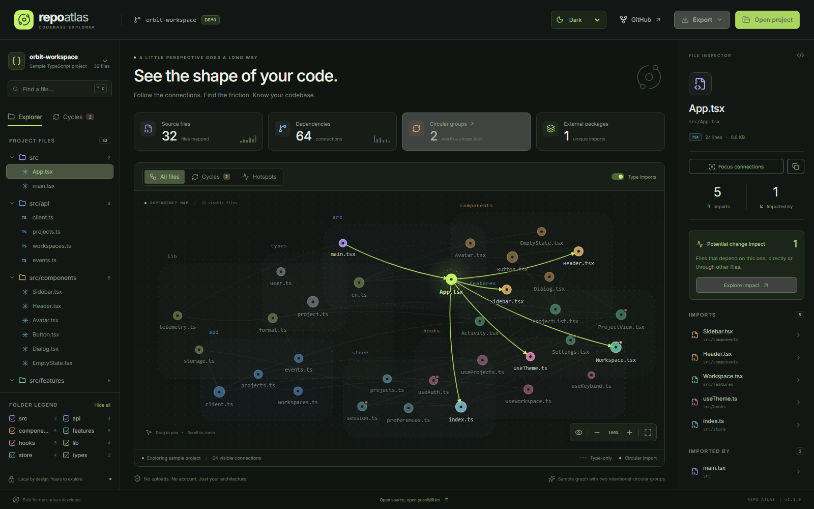

# Repo Atlas 🪐

**Nhìn thấy cấu trúc code, thay vì chỉ đọc từng file.**

[Mở demo](https://hiamtrung103.github.io/repo-atlas/) · [English](../README.md)

Repo Atlas quét project JavaScript/TypeScript và biến quan hệ import thành bản đồ tương tác. Click một file để xem nó dùng những gì, được những file nào dùng, có nằm trong nhóm import vòng hay không.



## Chạy trên máy

Cần Node.js 20.19+ hoặc 22.12+ và npm.

```bash
git clone https://github.com/hiamtrung103/repo-atlas.git
cd repo-atlas
npm ci
npm run dev
```

Mở URL Vite in ra, chọn **Open project → Choose a project folder**. Thử `examples/tiny-project` nếu muốn quét project mẫu thật; project này cố ý có một nhóm import vòng.

Bạn cũng có thể xuất bản đồ bằng CLI:

```powershell
npm run scan -- "D:\Projects\My App" --out my-app.atlas.json
```

Sau đó chọn **Open project → Import an Atlas graph** để mở JSON. CLI không ghi đè file đã tồn tại; chọn tên output mới khi quét lại.

## Có gì để khám phá?

- Bản đồ tô màu theo thư mục, kéo để di chuyển, cuộn hoặc bấm nút để zoom.
- Tìm file bằng tên hoặc đường dẫn; `Ctrl/⌘ K` đưa con trỏ tới ô tìm kiếm.
- **Cycles:** các nhóm file có thể đi tới nhau qua chuỗi import. Đây là nhóm liên thông mạnh, không phải danh sách theo thứ tự vòng.
- **Hotspots:** 20% file có tổng số liên kết cao nhất. Node lớn hơn có nhiều liên kết hơn.
- **Focus connections:** chỉ xem file đang chọn, các file nó import và những file import nó trực tiếp. Có nút copy đường dẫn trong inspector.
- **Explore impact:** lần theo các file phụ thuộc trực tiếp hoặc gián tiếp vào file đang chọn. Số đếm không tính chính file đó; đây là quan hệ cấu trúc, không khẳng định một thay đổi sẽ gây lỗi runtime.
- **Light / Dark / System:** chuyển giao diện ở thanh trên cùng; mặc định theo hệ thống. Lựa chọn được lưu qua lần tải lại, và SVG xuất ra giữ đúng màu giao diện hiện tại.
- **Type imports:** bật/tắt import chỉ dùng cho kiểu dữ liệu. Đường nét đứt thể hiện type-only import.
- Xuất JSON, SVG của bản đồ hiện tại hoặc báo cáo Markdown.

## Phạm vi bản đầu

Hỗ trợ import/export, dynamic import với đường dẫn cố định, CommonJS `require`, alias khai báo trực tiếp trong `tsconfig`/`jsconfig`. Chưa giải quyết config `extends`, package exports, workspace packages hay alias riêng của bundler. Các import nội bộ chưa tìm được sẽ hiện ở phần scan notes.

Giới hạn 2.500 file nguồn, 15 MB tổng nội dung nguồn/config và 1 MB mỗi file. Bản đồ vẽ tối đa 350 file phù hợp một lúc để giữ tương tác mượt; dùng tìm kiếm và bộ lọc để khám phá phần còn lại. Phân tích và JSON vẫn giữ toàn bộ graph.

App bỏ qua thư mục dependency/build phổ biến nhưng không đọc quy tắc `.gitignore` hay include/exclude của tsconfig. Demo có dữ liệu minh họa; quét thư mục thật sẽ tính metadata thật.

## Dữ liệu ở đâu?

Code được xử lý trong bộ nhớ trình duyệt bằng Web Worker, không upload lên server. Font được đóng gói cùng app; không có analytics. Reload sẽ xóa project đang mở khỏi bộ nhớ.

Chỉ lựa chọn giao diện được lưu trong local storage. Nếu trình duyệt chặn lưu trữ, bạn vẫn đổi theme được trong lần mở hiện tại.

File JSON xuất ra không có nội dung code, nhưng có đường dẫn tương đối, quan hệ import, số dòng/dung lượng và tên package. Kiểm tra trước khi chia sẻ cấu trúc project riêng.

Chi tiết kiến trúc, giới hạn và lệnh kiểm thử nằm trong [README tiếng Anh](../README.md).
